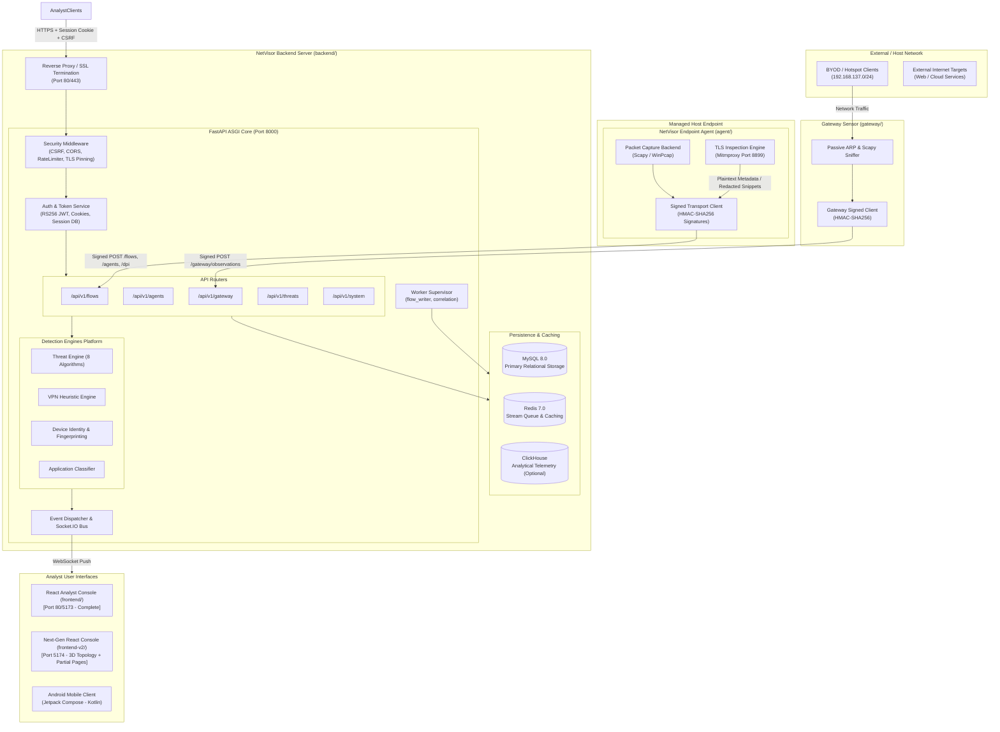

# Project Discovery Report: NetVisor

**Date of Discovery:** 2026-11-18  
**Repository Working Directory:** `C:\Users\prem\Network`  
**Auditor Mode:** Stage 1 Discovery (Strictly Read-Only / Zero Production Code Alterations)  

---

## 1. Ground Truth: What the System Actually Does (Verified in Code)

**NetVisor** is an enterprise-oriented, self-hosted network security monitoring and endpoint telemetry workspace designed to monitor managed devices, capture network traffic flows, inspect TLS/HTTP metadata, detect VPN/tunnel anomalies, evaluate security threat indicators, and provide an analyst console.

### Key Functional Capabilities (Verified by Code and Execution):
1. **FastAPI Ingestion & REST Control Plane (`backend/`):**
   - Ingests endpoint flows (`/api/v1/flows`), agent heartbeats/metrics (`/api/v1/agents`), web DPI observations (`/api/v1/dpi`), and gateway network scans (`/api/v1/gateway`).
   - Implements role-based access control (`admin`, `analyst`, `viewer`), HTTP-only Lax/Strict session cookies with CSRF token protection, and dual JWT support (RS256 asymmetric with HS256 legacy fallback).
   - Serves real-time WebSocket / Socket.IO events for live dashboard metric updates and high-severity security alert broadcasts.
2. **Detection Engines Platform (`backend/engines/`):**
   - **Threat Engine:** 8 deterministic and behavioral threat algorithms: beaconing pattern detection, SSH/RDP brute force, DNS entropy calculation (DGA detection), Kerberoasting / pass-the-hash indicators, horizontal/vertical port scans, SMB traversal, and anomalous outbound data exfiltration.
   - **VPN Engine:** Evaluates multi-factor indicators: Tor exit node IP cache matching (2,780+ live IPs), WireGuard fixed handshake packet sizing (148B initiation, 92B response), OpenVPN opcode parsing, TLS certificate issuer inspection, and ASN classification.
   - **Application & Device Engines:** Correlates MAC, OUI, OS fingerprinting, JA4 client signatures, and TLS SNI to build unified device identities and discovered software catalogs.
3. **Endpoint Agent (`agent/`):**
   - Python-based host daemon utilizing Scapy / native socket capture for local flow extraction, OS metrics collection (`psutil`), and an embedded mitmproxy-based TLS inspection engine (`agent/dpi/`).
   - Authenticates to backend using HMAC-SHA256 signed request envelopes with monotonic timestamps and nonces (`X-Agent-Id`, `X-Agent-Timestamp`, `X-Agent-Nonce`, `X-Agent-Signature`).
4. **Gateway Sensor (`gateway/`):**
   - Passive and active ARP/traffic metadata collector designed for BYOD / hotspot environments (e.g., Windows Mobile Hotspot on `192.168.137.0/24`), collecting unmanaged device metadata without payload invasion.
5. **Analyst Consoles & Client Ecosystem:**
   - **Frontend v1 (`frontend/`):** Production-ready React 18 + Vite 6 + Tailwind CSS dashboard covering all SOC routes (Dashboard, Devices, Applications, Threats, Activity, VPN, DPI, Logs, Settings, Users). Verified with 61 passing Vitest tests and successful production build.
   - **Frontend v2 (`frontend-v2/`):** Next-gen modernization with Tailwind v4, Three.js 3D topology graph, and React Flow. Completed for `/` (Dashboard) and `/devices`, but retains `PlaceholderPage.jsx` for 6 sub-routes (`/agents`, `/apps`, `/threats`, `/activity`, `/vpn`, `/settings`).
   - **Android Application (`Android_Application/`):** Mobile client in Kotlin + Jetpack Compose. Contains 12 full screen implementations and ViewModels, but has empty `// TODO:` route lambdas in `NavGraph.kt`.

### README Claims vs Code Reality Discrepancies:
- **Claim:** The README highlights transparent QUIC / HTTP/3 inspection.
  - **Reality (Refuted in Audit):** `packet_engine/quic_parser.py` extracts Initial packet header fields but completely lacks QUIC decryption (no HKDF, no AES-GCM/ChaCha20, no header protection removal). It passes raw encrypted ciphertext into the TLS ClientHello parser, failing on real-world QUIC handshakes unless QUIC is forced to fall back to TCP.
- **Claim:** Zero-copy packet aggregation and pooling.
  - **Reality:** While `packet_engine/object_pool.py` and `ring_buffer.py` exist, production ingestion paths in `agent/main.py` instantiate fresh dictionaries and Pydantic models per packet, bypassing the object pool.
- **Claim:** Real-time ClickHouse telemetry logging.
  - **Reality:** ClickHouse client connector is declared in requirements, but primary runtime flow persistence currently relies on MySQL `flow_logs` and `flow_batches` tables with optional Redis stream queuing.

---

## 2. As-Is Architecture & Trust Boundaries



### Trust Boundaries & Security Enclaves:
1. **Analyst Client Boundary:** Enforces HTTPS, HTTP-only SameSite cookies, CSRF tokens (`X-XSRF-TOKEN`), and role-based route guardrails.
2. **Agent / Gateway Sensor Boundary:** Strict cryptographic boundary. Requests require timestamp validation within a 60-second window, single-use nonces checked in Redis/MySQL, and HMAC-SHA256 request body signatures.
3. **Internal Data Plane Boundary:** Direct access to MySQL, Redis, and internal system management APIs restricted to loopback / Docker network.

---

## 3. Technology Stack & Versions

| Layer | Technology | Version | Location / Manifest |
| :--- | :--- | :--- | :--- |
| **Language Runtime** | Python | 3.13.7 (Win64) | `.venv/` |
| **Backend Framework** | FastAPI | 0.128.0 | `requirements/server.txt` |
| **ASGI Server** | Uvicorn | 0.40.0 | `requirements/server.txt` |
| **Database Driver** | mysql-connector-python | 9.5.0 | `requirements/server.txt` |
| **Database Engine** | MySQL Server | 8.0 | `docker-compose.yml` |
| **Cache & Queue** | Redis | 7.0 / 8.0.1 (py) | `docker-compose.yml` |
| **Analytical DB** | ClickHouse | 23.8 / 1.3.0 (py)| `docker-compose.yml` |
| **Realtime WebSockets** | python-socketio | 5.16.3 | `requirements/server.txt` |
| **Data Validation** | Pydantic v2 | 2.12.5 | `requirements/server.txt` |
| **Security & Crypto** | cryptography / python-jose | 46.0.5 / 3.5.0 | `requirements/server.txt` |
| **Packet Parsing** | dpkt / Scapy | 1.9.8 / 2.5.0 | `requirements/agent.txt` |
| **TLS Proxy Engine** | mitmproxy | 12.2.1 | `requirements/agent.txt` |
| **Node.js Runtime** | Node.js / npm | v24.13.0 / 11.15.0| Global Host |
| **Frontend v1** | React / Vite / Tailwind | 18.3.1 / 6.0.5 / 4.2.2| `frontend/package.json` |
| **Frontend v2** | React / Vite / Three.js | 18.3.1 / 6.0.5 / 0.187.0| `frontend-v2/package.json` |
| **Mobile Runtime** | Android SDK / Jetpack Compose| Kotlin 2.0+ / Compose 1.7| `Android_Application/` |

### How to Run:
- **Backend Health Check:**
  ```powershell
  .\.venv\Scripts\python.exe run_server.py --health-check
  ```
- **Backend Development Server:**
  ```powershell
  .\.venv\Scripts\python.exe run_server.py
  ```
- **Frontend v1 Console (Production Complete):**
  ```powershell
  npm --prefix frontend run dev
  ```
- **Frontend v2 Next-Gen Console:**
  ```powershell
  npm --prefix frontend-v2 run dev
  ```
- **Run Full Python Test Suite:**
  ```powershell
  .\.venv\Scripts\pytest.exe -q --disable-warnings
  ```
- **Run Frontend Tests:**
  ```powershell
  npm --prefix frontend test
  ```

### Test Verification Status:
- **Python Pytest Suite:** **936 passed**, 37 skipped (hardware interface tests), 0 failed across 121 test modules (Duration: 337s).
- **Frontend Vitest Suite:** **61 passed**, 0 failed across 8 test suites (Duration: 39s).
- **Frontend Builds:** Both `frontend/` and `frontend-v2/` build production bundles with zero errors.

---

## 4. Configuration & Secrets Inventory

| Environment Variable | Category | Purpose | Default / Status | Exposure Risk |
| :--- | :--- | :--- | :--- | :--- |
| `NETVISOR_SECRET_KEY` | Auth | JWT and session signing secret | User-defined | Protected in `.env` (gitignored) |
| `NETVISOR_JWT_ALGORITHM`| Auth | Signing algorithm | `RS256` | Safe |
| `NETVISOR_JWT_PRIVATE_KEY_PATH` | Crypto | RSA Private key file path | `keys/jwt_private.pem` | Protected in `keys/` (gitignored) |
| `NETVISOR_JWT_PUBLIC_KEY_PATH` | Crypto | RSA Public key file path | `keys/jwt_public.pem` | Protected in `keys/` (gitignored) |
| `NETVISOR_AGENT_MASTER_KEY` | Auth | Symmetric bootstrap master key | User-defined | Protected in `.env` (gitignored) |
| `NETVISOR_GATEWAY_MASTER_KEY`| Auth | Symmetric gateway bootstrap key | User-defined | Protected in `.env` (gitignored) |
| `AGENT_API_KEY` | Auth | Fallback agent static key | User-defined | Protected in `.env` (gitignored) |
| `GATEWAY_API_KEY` | Auth | Fallback gateway static key | User-defined | Protected in `.env` (gitignored) |
| `NETVISOR_DB_PASSWORD` | Database | MySQL root/user password | User-defined | Protected in `.env` (gitignored) |
| `NETVISOR_REDIS_PASSWORD`| Database | Redis authentication password | User-defined | Protected in `.env` (gitignored) |
| `NETVISOR_BOOTSTRAP_ADMIN_PASSWORD` | Auth | Initial admin bootstrap password | User-defined | Protected in `.env` (gitignored) |

**Secrets Audit Verification:**
- Git history searched with `git log -p -S "BEGIN PRIVATE KEY"`. Zero committed private keys found.
- `.env`, `.env.*`, `keys/`, `*.key`, `*.pem` strictly present in `.gitignore`.
- `.env.example` verified sanitized: all secrets populated with placeholders (`generate_a_secure_key_here`, `change_me`).

---

## 5. Repository Health Assessment

1. **Dead Code & Compatibility Shims:**
   - `collector/*.py` contains 7 one-line forwarding wrappers re-exporting modules from `packet_engine/`.
   - `netvisor_frontend_3.0/` is an unreferenced legacy prototype directory duplicating UI modules.
   - 65 unreferenced or test-only functions cataloged in `dead_code_report.md` (e.g. `_verify_port_listening`, redundant MAC detectors).
2. **Duplication:**
   - Multiple frontend versions: `frontend/` (v1 - complete), `frontend-v2/` (v2 - modern 3D UI, partial sub-routes), and `netvisor_frontend_3.0/` (stale prototype).
   - Ingestion path duplication: `agent/dpi/mitm_addon.py` has local regex `redact_url_secrets()` while `agent/dpi/redaction.py` has full AST `redact_url()`.
3. **Repository Cleanliness:**
   - `tmp/` contains orphaned `netvisor-gateway-transport-*` test directories with locked Windows handles.
   - Root directory contains stale archive dumps: `agent.zip`, `frontend-v2.zip`, `NetVisor_project.zip`, `all_code.txt`. All are ignored by Git.

---

## 6. Strong Points to Preserve

1. **Robust Cryptographic Architecture:**
   - Nonce-based replay protection with HMAC-SHA256 signature verification on agent/gateway data plane.
   - Dual-algorithm JWT authentication supporting RS256 asymmetric keys.
   - HttpOnly, SameSite cookies with timing-safe CSRF header matching.
2. **Comprehensive Detection Platform:**
   - Sophisticated threat engine covering 8 distinct behavioral attack vectors.
   - High-precision VPN detection integrating WireGuard packet lengths, Tor exit node lists, and ASN reputation.
3. **Exceptional Automated Test Rigor:**
   - 936 passing Python tests and 61 passing frontend tests covering edge cases, concurrency, adversarial payloads, and failure recovery.
4. **Data Durability & Backup Subsystem:**
   - Built-in `system_service.export_all_tables_to_db_dump` and automated backup retention policies ensuring zero data loss during restarts.
