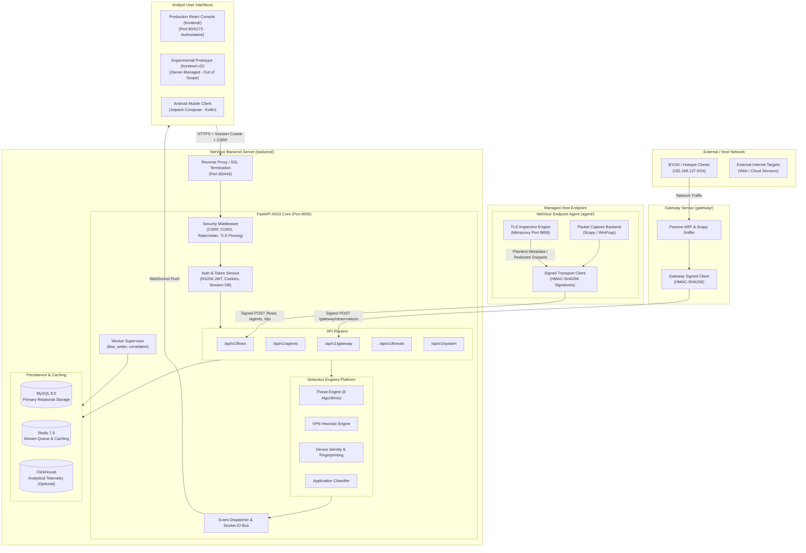

# Project Discovery Report: NetVisor

**Date of Discovery:** 2026-11-18 (Updated Stage 2b Reconciliation)  
**Repository Working Directory:** `.`  
**Auditor Mode:** Stage 2b Corrective Audit (Zero Feature Alterations)  

---

## 1. Ground Truth: What the System Actually Does (Verified in Code)

**NetVisor** is a self-hosted network security monitoring and endpoint telemetry workspace designed to monitor managed devices, capture network traffic flows, inspect TLS/HTTP metadata, detect VPN/tunnel anomalies, evaluate security threat indicators, and provide an analyst console.

### Key Functional Capabilities (Verified by Code and Execution):
1. **FastAPI Ingestion & REST Control Plane (`backend/`):**
   - Ingests endpoint flows (`/api/v1/flows`), agent heartbeats/metrics (`/api/v1/agents`), web DPI observations (`/api/v1/dpi`), and gateway network scans (`/api/v1/gateway`).
   - Implements role-based access control (`admin`, `analyst`, `viewer`), HTTP-only Lax/Strict session cookies with CSRF token protection, and JWT support (RS256 asymmetric with legacy HS256 fallback).
   - Serves real-time WebSocket / Socket.IO events for live dashboard metric updates and high-severity security alert broadcasts.
2. **Detection Engines Platform (`backend/engines/`):**
   - **Threat Engine:** 8 deterministic and behavioral threat algorithms: beaconing pattern detection, SSH/RDP brute force, DNS entropy calculation (DGA detection), Kerberoasting / pass-the-hash indicators, horizontal/vertical port scans, SMB traversal, and anomalous outbound data exfiltration.
   - **VPN Engine:** Evaluates multi-factor indicators: Tor exit node IP cache matching (2,780+ live IPs), WireGuard fixed handshake packet sizing (148B initiation, 92B response), OpenVPN opcode parsing, TLS certificate issuer inspection, and ASN classification.
   - **Application & Device Engines:** Correlates MAC, OUI, OS fingerprinting, JA4 client signatures, and TLS SNI to build unified device identities and discovered software catalogs.
3. **Endpoint Agent (`agent/`):**
   - Python-based host daemon utilizing Scapy / native socket capture for local flow extraction, OS metrics collection (`psutil`), and an embedded mitmproxy-based TLS inspection engine (`agent/dpi/`).
   - Authenticates operational requests to the backend using HMAC-SHA256 signed request envelopes with monotonic timestamps and nonces (`X-Agent-Id`, `X-Agent-Timestamp`, `X-Agent-Nonce`, `X-Agent-Signature`).
4. **Gateway Sensor (`gateway/`):**
   - Passive and active ARP/traffic metadata collector designed for BYOD / hotspot environments (e.g., Windows Mobile Hotspot on `192.168.137.0/24`), collecting unmanaged device metadata without payload invasion.
5. **Analyst Consoles & Client Ecosystem:**
   - **Frontend v1 (`frontend/`):** Authoritative production React 18 + Vite 6 + Tailwind CSS dashboard covering all SOC routes (Dashboard, Devices, Applications, Threats, Activity, VPN, DPI, Logs, Settings, Users). Deployed via `docker-compose.yml`. Verified with 61 passing Vitest tests and successful production build.
   - **Frontend v2 (`frontend-v2/`):** Owner-managed experimental prototype with Tailwind v4, Three.js 3D topology graph, and React Flow. **Out of scope for team development per owner decision.**
   - **Android Application (`Android_Application/`):** Mobile client in Kotlin + Jetpack Compose. Contains 12 screen implementations. `MainActivity.kt` and `NavGraph.kt` wire full navigation across all screens.

### Tenancy Model in Practice:
- **Single-Organization in Practice:** While the MySQL schema defines `organization_id` foreign keys and tenant-scoping logic exists in query layers, the application defaults to `SINGLE_ORG_MODE=True` (`backend/core/config.py:192`). In `backend/api/agents.py:137` and `backend/api/gateway.py:142`, enrollment requests automatically override requested organizations and bind devices to `DEFAULT_ORGANIZATION_ID`. Multi-tenancy is not active in production runtime.

### Claims vs Code Reality Discrepancies:
- **QUIC Inspection:** `packet_engine/quic_parser.py` extracts Initial packet header fields but completely lacks QUIC decryption (no RFC 9001 HKDF, no AES-GCM/ChaCha20, no header protection removal). NetVisor relies on blocking UDP/443 firewall rules (`NETVISOR_DPI_ENABLE_QUIC_BLOCK=true`) to force browser fallback to standard TLS 1.3 over TCP. Claims of "100% wire-level inspection fidelity" for QUIC are inaccurate; inspection succeeds only via forced protocol fallback.
- **WinDivert Kernel Capture:** WinDivert is **NOT IMPLEMENTED** in the codebase. Only a comment string in `packet_engine/types.py:10` references the term. Live packet capture exclusively uses Scapy / Npcap / raw sockets.
- **Zero-Copy / Object Pool:** `packet_engine/object_pool.py` is uncalled on the hot path in `agent/main.py` or `dpkt_parser.py`. Standard heap allocations occur per packet.
- **Redis vs Synchronous MySQL Ingestion:** The transition to purely asynchronous streaming is incomplete. When Redis is unavailable or bypassed, flow ingestion falls back to synchronous row-locked writes in `flow_service.py`. Claims of "Redis streaming complete" conflict with active bottleneck AUD-004.
- **Scapy Overhead Claims:** Claims of a specific "15x Scapy bottleneck" are unmeasured assertions. Scapy introduces Python interpretation overhead relative to C-native packet capture, but exact multi-fold ratios vary by packet arrival rate and framing.

---

## 2. As-Is Architecture & Trust Boundaries



---

## 3. Technology Stack & How to Run

| Layer | Technology | Version | Location / Manifest |
| :--- | :--- | :--- | :--- |
| **Language Runtime** | Python | 3.13.7 (Win64) | `.venv/` |
| **Backend Framework** | FastAPI | 0.128.0 | `requirements/server.txt` |
| **ASGI Server** | Uvicorn | 0.40.0 | `requirements/server.txt` |
| **Database Driver** | mysql-connector-python | 9.5.0 | `requirements/server.txt` |
| **Database Engine** | MySQL Server | 8.0 | `docker-compose.yml` |
| **Cache & Queue** | Redis | 7.0 / 8.0.1 (py) | `docker-compose.yml` |
| **Analytical DB** | ClickHouse | 23.8 / 1.3.0 (py)| `docker-compose.yml` |
| **Realtime WebSockets** | python-socketio | 5.16.3 | `requirements/server.txt` |
| **Data Validation** | Pydantic v2 | 2.12.5 | `requirements/server.txt` |
| **Packet Parsing** | dpkt / Scapy | 1.9.8 / 2.5.0 | `requirements/agent.txt` |
| **TLS Proxy Engine** | mitmproxy | 12.2.1 | `requirements/agent.txt` |
| **Production Frontend**| React / Vite / Tailwind | 18.3.1 / 6.0.5 / 4.2.2| `frontend/package.json` |
| **Mobile Client** | Android SDK / Jetpack Compose| Kotlin 2.0+ / Compose 1.7| `Android_Application/` |

### How to Run:
- **Backend Health Check:**
  ```powershell
  .\.venv\Scripts\python.exe run_server.py --health-check
  ```
- **Backend Development Server:**
  ```powershell
  .\.venv\Scripts\python.exe run_server.py
  ```
- **Production Frontend Console (`frontend/`):**
  ```powershell
  npm --prefix frontend run dev
  ```
- **Run Full Python Test Suite (with scratch test DB password):**
  ```powershell
  $env:NETVISOR_DB_PASSWORD="your_password"; .\.venv\Scripts\pytest.exe -q --disable-warnings
  ```
- **Run Frontend Tests:**
  ```powershell
  npm --prefix frontend test
  ```

---

## 4. Configuration & Secrets Inventory

- **PEM Private Key Scan:** No match for regex pattern `-----BEGIN [A-Z0-9 ]*PRIVATE KEY-----` across 3,223,424 lines of git diff history.
- **Generic Hardcoded Secret Scan across History:** 19 distinct committed historical strings found in legacy commits (e.g., `Prem@333` in old database config, `NetVisor!DemoAccess99` in legacy seed scripts).
- **Local Uncommitted Secrets:**
  - Real RSA signing private keys (`jwt_private.pem`, `dev_signing_key.pem`, `prod_signing_key.pem`) reside in local `keys/` directory (gitignored).
  - Untracked root dump file `all_code.txt` (6MB) contains plain-text demo credentials (`NetVisor!DemoAccess99`, `bootstrap-key`).
- **Static API Keys:** `AGENT_API_KEY` and `GATEWAY_API_KEY` are used strictly for initial device bootstrap registration (`/api/v1/agents/register` and `/api/v1/gateway/register`). Operational communication mandates asymmetric or HMAC-SHA256 nonced request envelopes.

---

## 5. Strong Points to Preserve

1. **Cryptographic Nonce & Replay Enforcement:** Monotonic timestamps and nonces with HMAC-SHA256 signature verification enforce data plane integrity for enrolled agents and gateways.
2. **Comprehensive Detection Platform:** Deterministic behavioral threat engine (8 attack patterns) and high-precision VPN heuristics (WireGuard packet lengths, Tor exit node feeds).
3. **Automated Test Coverage:** 970 passing tests when database credentials are supplied (61 Vitest tests on the production frontend; 969 unit/integration Python tests).
4. **Data Durability & Scheduled Exports:** Automated database export routines to `db_dump/` on process exit and retention prune routines.
